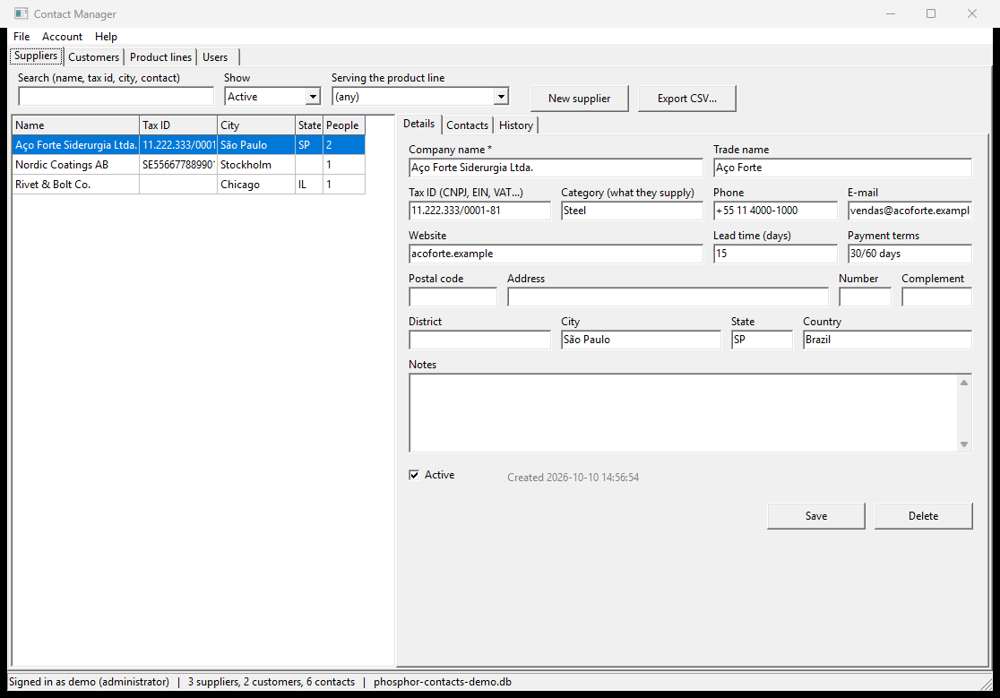
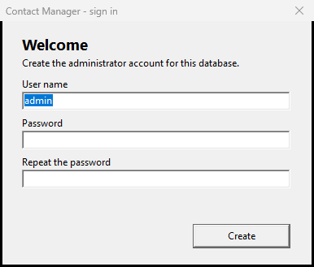
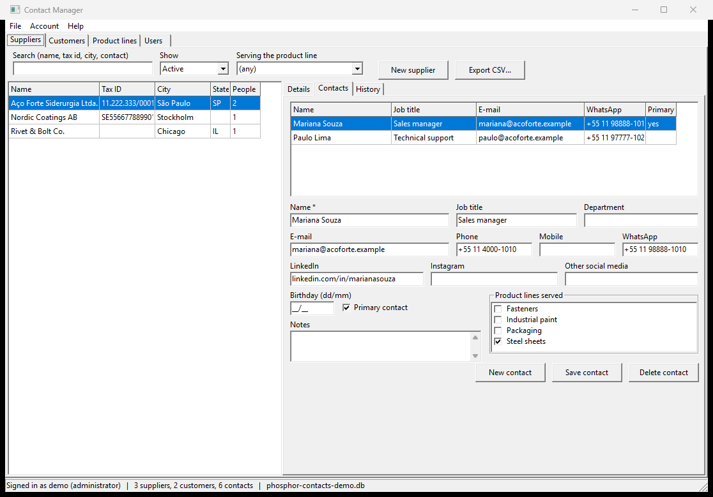
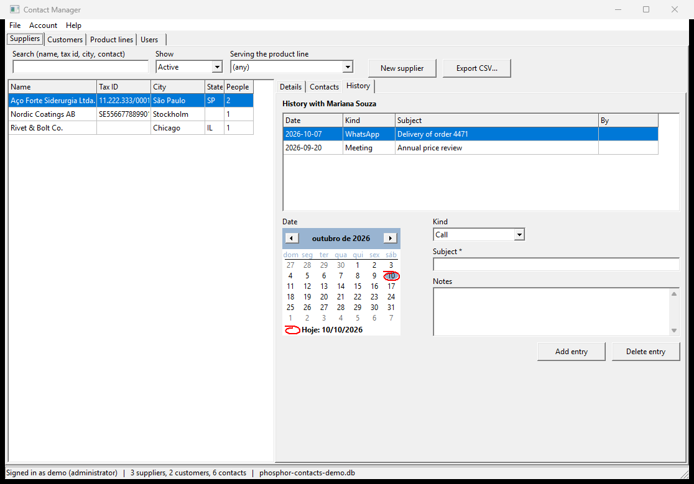

# Contact Manager — a whole application in Phosphor BASIC

[`examples/contact_manager.bas`](../examples/contact_manager.bas) is a desktop
program for the people a company buys from and sells to: suppliers and
customers, the contacts at each one, the product lines those contacts serve,
and a dated history of what was said to whom. It keeps everything in SQLite,
behind a login with users, roles and hashed passwords, and it is one file of
BASIC — about 3,850 lines, a fifth of them the self-test.

It is here for two reasons: to show what the language and its libraries add up
to, and because writing it was this project's first real use. It found five
things the test suites had not, listed at the end.



## Run it

It needs the SQLite runtime: `sqlite3.dll` beside `phosphor.exe` on Windows
(the 64-bit DLL from [sqlite.org](https://www.sqlite.org/download.html)), or
`libsqlite3` on Linux, which most distributions install already.

```bash
phosphor examples/contact_manager.bas
```

The first run asks you to create the administrator account and offers to load
a few sample companies.



The data lives in `phosphor-contacts.db` in your Documents folder — or in your
home folder where there is no Documents folder, as on a Linux without
`~/Documents`. **File > Open database...** opens another one, and so does
naming it on the command line (`phosphor examples/contact_manager.bas my.db`)
or in the environment variable `PHOSPHOR_CONTACTS_DB`. A file that cannot be
used — not a database, in a folder that does not exist, made by a newer version
of the program, **another program's SQLite database** — is refused with the
reason: at start-up the program then offers to pick another file or to end,
and from **File > Open database...** it keeps the database you had open, and
your session with it. Nothing is written into a file before the program knows
it is its own: an empty file, one it marked as its own, or one an earlier
version made (recognised by its tables and columns). It asks that of the
file's **bytes** first — the 100-byte SQLite header, read as a plain file:
the magic `SQLite format 3`, `user_version` at offset 60 and `application_id`
at offset 68 — because SQLite itself does more than read: a *hot journal*
left beside a file (`name-journal`, from a program killed in mid-transaction)
is rolled back into the file by the first query, even a `PRAGMA` on a
read-only connection. So a file another program marked is refused without
being opened. An unmarked one with unfinished work beside it — a journal
SQLite would act on, or a write-ahead log — is this program's own most likely
crash — an upgrade marks the file only as its last step, so one killed in
mid-upgrade is unmarked with a hot journal, and so is a first run killed
before its first commit — and it is judged on a **copy**: the file and what
lies beside it are copied to the temp folder, SQLite opens the copy and does
there exactly what it would do to the file (rolls the journal back, applies
the log, or deletes a journal it has no use for), and the copy's owner is the
file's. The program's own file then opens and is upgraded again; another
program's is refused, naming the journal and its tables, and it and its
journal are left byte for byte as they were. So is a file whose header is
not a database's at all while such a journal lies beside it — a first page
torn by a power cut is what a journal exists to put back, and the program's
own file comes back whole. What counts as unfinished work is what SQLite
counts: a journal whose header is zeroed is one a program *finished* with in
`PERSIST` mode, not a crash, and SQLite leaves it alone, so the program does
too — and says a program stopped in the middle of a change only when the
journal shows one. And the journal looked for is the one SQLite will find,
beside the file **as SQLite names it**: SQLite follows a symbolic link to its
target on Linux and drops a trailing dot on Windows, so the journal it would
roll back into `docs/phosphor-contacts.db` linked to `other.db`, or into
`x.db.`, is `other.db-journal` or `x.db-journal` — not the one beside the name
you gave. The program asks SQLite for that name (`PRAGMA database_list`, before
any query) and judges the journal beside it.
A file that carries the program's mark is not trusted on the mark alone
either: one without every table, column, index and foreign key its version
has is refused as damaged, naming what is missing — the uniqueness of user
names, product lines and tax ids lives in those indexes and nowhere else.
Those are compared the way SQLite compares names, ignoring the case of A–Z:
an index spelled `UX_USERS_USERNAME_KEY`, a collation spelled `nocase` or a
column renamed in capitals is the same one. An unmarked file that has at
least one of an earlier version's tables whole, but has lost a part — a
column, an index, whole tables — is refused naming that part, as a damaged
copy of an earlier version's file or another program's. A read-only database at
the current version opens for looking: the sign-in says so, and every change
is refused. A read-only database **from an earlier version** is refused
instead, saying so: opening it means upgrading it, which writes to it, and the
program does not look at an old file as it is, because it would answer some
sign-ins and searches by the old rule. Open a writable copy of it — the copy
is upgraded and the original stays as it was.

Upgrading a large database takes a moment — about 3 seconds for 16,000
companies, 11 for 50,000 — and a small window says so while it runs.

To look around without creating anything, start it with
`PHOSPHOR_CONTACTS_DEMO=1`: it opens a throw-away database in the temp folder
with the sample data, signed in as `demo` (password `demo123`).

```bash
PHOSPHOR_CONTACTS_DEMO=1 phosphor examples/contact_manager.bas
```

```powershell
$env:PHOSPHOR_CONTACTS_DEMO = '1'; phosphor examples\contact_manager.bas
```

## What it does

| page | what is on it |
| --- | --- |
| **Suppliers**, **Customers** | a list you can search by name, tax id (with or without its punctuation), city or the name of a contact — ignoring case in any alphabet (`AÇO` finds `Aço`), and taking `%` and `_` as the characters they are — and filter by active state and by the product line a contact serves. The selected company's **Details** (address, tax id, category or segment, lead time or credit limit, payment terms, notes, active flag, who created and changed it), its **Contacts**, and the **History** of the selected contact. A double click on a company opens its contacts. For a Brazilian company the tax id must be a valid CNPJ — numeric or, since July 2026, alphanumeric — or CPF |
| Contacts | name, job title, department, e-mail, phone, mobile, WhatsApp, LinkedIn, Instagram and other social media, birthday (a real day and month, `dd/mm`, or empty), notes, a primary-contact flag (one per company), and the product lines the contact serves |
| History | dated entries per contact — a call, a meeting, an e-mail, a WhatsApp message, a visit — with a subject, notes and who wrote it. **Delete entry** acts on the entry you picked in the list, and its question names it |
| **Product lines** | the lines your contacts serve, used by the contacts' check list and by the filters |
| **Users** | administrators only: users, their role (administrator or operator), whether they may sign in, and their passwords |

The **File** menu exports suppliers or customers to CSV (one row per contact,
with the product lines it serves) and backs the database up — to any file but
the open database itself, which it refuses under any name: another letter case
on a folder that ignores case, a trailing dot on Windows, a link. Comparing the
names catches only the spelling that matches, so a name that is spelled
differently and already exists is asked of the files: the program leaves a
mark in the open database and looks for it in the target, opened read-only
— after the target's header has been read as bytes, so that a file without the
program's mark is known to be another file without SQLite ever opening it. A
file that is already there is replaced only once it is proven to be another
file, and only if you say so. A name ending in `-journal`, `-wal` or `-shm` is
refused outright: that is where SQLite keeps a database's unfinished work, and
a backup there would be cut short by the open database or taken for the
unfinished work of the file beside it. So is a name that *leads* to one: a
symbolic link that points at nothing is no file, so nothing above stops it,
and SQLite would write the backup through it to wherever it points — the name
the backup will be written under is asked of SQLite first. "Backed up" is said only once the copy
has been read back. **Account** changes your own password and signs out.





## How it is built

### SQLite carries the rules

The schema (`create_schema` in the program) makes the database refuse what the
program should never write, so a bug in the BASIC cannot corrupt it:

- **Foreign keys with `ON DELETE CASCADE`.** Deleting a company deletes its
  contacts, their product-line links and their history in one statement.
  `PRAGMA foreign_keys = ON` is run on every open, because SQLite leaves it off.
- **`ON DELETE SET NULL`** on "who created this": deleting a user keeps their
  records.
- **A partial unique index** — one tax id per kind of company, while many may
  leave it blank: `CREATE UNIQUE INDEX ... ON companies(kind, tax_key) WHERE tax_key <> ''`.
  `tax_key` is the id upper-cased with only its letters and digits kept, so
  `11.444.777/0001-61` and `11444777000161` are one id.
- **Unique keys that ignore case in any alphabet.** SQLite's `COLLATE NOCASE`
  and `LIKE` fold the 26 ASCII letters only, which made `josé` and `JOSÉ` two
  users. So each name that must be unique regardless of case is stored beside
  a **case-folded** key — user names (`username_key`), product lines
  (`name_key`) — and the unique index is on the key: `Olivia` and `olivia`,
  `José` and `josé`, `ΣΩΚΡΑΤΗΣ` and `σωκρατης`, `STRASSE` and `straße` are the
  same user. The search compares keys made the same way, with
  `LIKE ... ESCAPE '\'`, so `οδυσσευς` finds `ΟΔΥΣΣΕΥΣ` and `WEISS` finds
  `Weiß`. Folding is not lower-casing: BASIC's `alcase$` maps one character to
  one, leaving a final `ς` and a `ß` as they are, where Unicode's case folding
  (CaseFolding.txt) makes them `σ` and `ss`. The program's `fold$` is `alcase$`
  followed by a table of the 505 characters where the two differ, derived
  from Unicode 15's folding and checked against Python's `str.casefold` for
  every code point. One differs, on purpose: the Turkish dotted capital `İ`
  (U+0130). (Until `alcase$` stopped answering `?` for them on 2026-10-10,
  the noncharacters U+FFFE and U+FFFF differed too.) Full folding makes it `i` followed by a combining dot; `fold$`
  makes it a plain `i`, because a key is for matching, and caseless matching
  drops the dot as Unicode's identifier matching drops marks. With the dot
  kept, a user `İLKER` could not sign in typing `ilker` or `ILKER`, and
  `istanbul` did not find `İSTANBUL TİCARET`. The stored keys depend on
  `alcase$`, which leaves a byte that is not valid UTF-8 as it is — and the
  text that reaches it is not always valid UTF-8: an edit control keeps
  whatever bytes it is given, and an upgrade keys the
  text an older file already holds, which another tool may have written. So
  a change in how `alcase$` treats such bytes would change those keys, and
  would need a schema version of its own. (It changed once already, from `?`
  to the byte itself, before version 3 shipped: every version-3 key is made
  the new way.) `fold$` steps over such a byte alone, as `alcase$` does, so
  a stray byte never hides the character after it from the fold.
- **A transaction** around saving a contact, its primary flag and its product
  lines: all of it or none of it.
- **A schema version**, kept in `PRAGMA user_version`, and since version 3
  the program's own mark in `PRAGMA application_id`. A database already at the
  current version is not written to when it is opened — which is what lets a
  read-only one open. An older one is upgraded inside one transaction that
  also sets the new version: version 1 to 2 added the keys above and replaced
  the tax-id index; version 2 to 3 recomputed the keys by case folding instead
  of lower-casing, and marked the file. The keys are computed once per upgrade,
  in time linear in the rows. If those rows already break the new rules — two
  users whose names differ only in case, `STRASSE` and `straße` among them,
  one tax id written two ways — the upgrade is refused with their names and
  the file is left as it was.

And **every value is bound**, never pasted into SQL — `?1`, `?2` and
`sqlite_bindstr` / `sqlite_bindnum` — so a company called `O'Brien; DROP TABLE`
is just a name:

```basic
key$ = alcase$(u$)    rem the program's fold$ goes further: see above
s@ = sqlite_prepare@(db@, "SELECT id, username, password, role, active FROM users WHERE username_key = ?1")
sqlite_bindstr(s@, 1, key$)
if sqlite_step(s@) = 1 then rec$ = sqlite_gets$(s@, "password")
sqlite_finalize(s@)
```

### Passwords are never stored

A password becomes a salted PBKDF2 record with `password_hash$`, and the login
asks `password_verify?` whether a typed password matches it
([libraries/crypto.md](libraries/crypto.md)). An unknown user name and a wrong
password get the same message, so the login does not tell a stranger which
names exist. The last active administrator cannot be demoted, deactivated or
deleted, so someone can always manage the users — a rule checked against the
database at each change, because another copy of the program on the same file
may have changed the users meanwhile. A change to your own account takes
effect at once: demote yourself and the Users page goes; deactivate yourself
and, after a confirmation, you are signed out.

### The windows

Every window is built in code: `form@`, a `mainmenu@`, a `statusbar@`, a
`pagecontrol@` with `tabsheet@` pages, and on them panels and group boxes,
`edit@` (with `PasswordChar` for passwords), a `maskedit@` for the birthday,
`memo@`, `combobox@` in drop-down-list style, a `checklistbox@` of product lines,
`checkbox@`, a `calendar@` and `button@`. The lists are `stringgrid@`s used as
record lists — whole-row selection, `stringgrid_onselect@` to load the picked
record, `stringgrid_colwidth@` for the columns, `control_ondblclick@` on the
company list. Messages, confirmations and the open and save dialogs are the
library's own.

Handlers are ordinary functions bound by name, and one handler serves both the
supplier and the customer page: each control carries the page's number in its
tag, and the handler reads `control_tag(sender@)`.

```basic
f@ = form@("Suppliers")
save@ = button@(f@)
button_caption@(save@, "Save")
control_tag@(save@, 1)          rem 1 = the suppliers page, 2 = the customers page
button_onclick@(save@, "on_company_save")

function on_company_save(sender@) local k
  k = control_tag(sender@)
  println "saving a record on page " + str$(k)
  return 0
end function
```

**Change my password** is a modal dialog: `form_showmodal` waits until it is
answered, its **Change** button answers `1` with `form_modalresult@` once the
new password is saved, and **Cancel** answers `2` through `button_modalresult@`.

### It tests itself

With `PHOSPHOR_SELFTEST=1` the program builds every window **without showing
one**, and drives them as a person would — typing with `edit_text@`, clicking
with `button_click@` and `menuitem_click@`, picking rows with
`stringgrid_cursor@`, double-clicking with `control_dblclick@` — against a
throw-away database, then checks what landed in SQLite: 205 checks, from the
first-run administrator to a cascade delete, the whole CSV file, an operator
who cannot see the Users page, Greek, German and Turkish names that differ
only in case, the upgrades from versions 1 and 2, another program's database
left byte for byte untouched — one with a hot journal beside it among them,
which the test makes by copying a file and its journal in the middle of a
transaction, and first checks that SQLite would roll it back, another with
its last change still in a write-ahead log, another beside a journal it
finished with, another beside a file that is no journal, and one reached by a
name whose journal SQLite looks for elsewhere — the program's own files left
unfinished (a version-2 file killed in mid-upgrade, the same with its first
page torn, a first run killed before its first commit, a spent journal), which
open, a damaged file carrying the program's mark (a table, a column, a unique
index or a foreign key gone) and one whose names differ only in case, which
opens, an earlier version's file that lost a table, and a backup onto the open
database under other spellings of its name or of its journal's. Its message, confirmation and file boxes go through functions the test
answers. `scripts/test-examples` runs it that way on Windows and on Linux
(under `xvfb-run`).

Two checks are about speed, and neither is a bound in seconds, which cannot
tell a slow machine from a slow program: they check the **shape**. A refresh of
20,000 companies must cost about eight times one of 2,500 (under twenty
times; a grid grown a row at a time made it forty), and the upgrade of 16,000
companies about eight times that of 2,000 (a per-row duplicate count made it
sixty).

The backup checks ask the **folder** whether a second spelling of a name
reaches the same file — a scratch file and its upper-cased or dotted name —
rather than assuming it from the operating system, so the same check expects a
refusal on Windows and on a Linux folder that ignores case, and a written
backup on one that does not.

The name SQLite resolves to another is the one check that differs by system:
on Windows it is the file's name with a trailing dot, on Linux the symbolic
link `/proc/self/fd/N` that Linux keeps for a file the process holds open — no
privilege is needed to make it, and a test cannot make any other link. Under
`--sandbox`, as `scripts/test-examples` runs it, SQLite opens no file through
a link at all, so on Linux there the pair checks that refusal instead (the
count is the same on both systems); the pair proper runs on Linux when the
self-test is started without a sandbox, `PHOSPHOR_SELFTEST=1 phosphor run
examples/contact_manager.bas`. A backup through a link that points at
nothing cannot be made by a test at all, and was proved by hand on Linux.

A check is only worth having if it can fail. An adversarial review found three
that could not — the CSV check looked at one quoted name, the credit-limit check
accepted any value, and the last-administrator check on deleting a user never
reached the rule it named — so they were rewritten, and each of them, and each
check added with the fixes of that review, was **seen to fail** in a copy of the
program with its rule reverted. The second review's fixes were held to the same
standard, on both systems: reverting the identity check, the read-back of a
backup, the linear duplicate check, the one-sizing of the grid, the folding,
its table probes, the dropped indexes of an upgrade, the owner check, the
prepare check and the read-only message each made its own checks fail. So did
the sixth review's: the plain `i` for `İ`, the header read at start-up and in
the backup's identity check, the table check of a marked file, and the
refusal of journal names — and a write slipped into the owner check, which
the old "nothing was written" check, counting tables, could not see. And the
seventh's: the old refusal of every unmarked file with a journal, the index
and foreign-key comparison, the same comparison asked of an older file in
full (which refuses every version-2 file, whose old tax-id index the upgrade
drops), a copy judged without its journal or log, a copy left behind, the
fold that stepped by a lead byte's width, and the earlier-version message.
And the eighth's: judging the name as given instead of SQLite's name for it
(on Windows, and on Linux without a sandbox), refusing a torn header before
its journal is looked at, comparing index, collation and column names byte for
byte, calling a file that lost a whole table one of "other tables", taking a
finished `PERSIST` journal for unfinished work, and describing every journal
as an interrupted change.

## What writing it changed in Phosphor

A real program finds what a test suite written by the same people does not:

- **The engine had no hash at all.** The crypto library
  ([libraries/crypto.md](libraries/crypto.md)) came from this program's login.
- **A grid could not say which row was picked**, nothing could take a double
  click, and every column had one width: `stringgrid_row` / `stringgrid_col` /
  `stringgrid_cursor@` / `stringgrid_onselect@`, `control_ondblclick@` /
  `control_dblclick@` and `stringgrid_colwidth@` came from its lists.
- **A `/` in an edit mask is not a slash.** The birthday field showed `14/03` on
  Windows and `14-  ` on Linux: the LCL reads `/` as the system's date
  separator. [libraries/gui-edit.md](libraries/gui-edit.md) now says so; `\/`
  is a slash everywhere.
- **A program could not read command-line arguments** — `phosphor run app.bas x`
  was refused — which is why this one took its switches from the environment.
  It can now (`paramstr$`, [libraries/sys.md](libraries/sys.md)), and the
  database can be named on the command line; the self-test and the demo stay
  environment switches, because `test-examples` sets them for a program it does
  not otherwise configure.
- **There were no modal forms**, so the password window first disabled the main
  one by hand. `form_showmodal`, `form_modalresult@` and `button_modalresult@`
  came from it.
